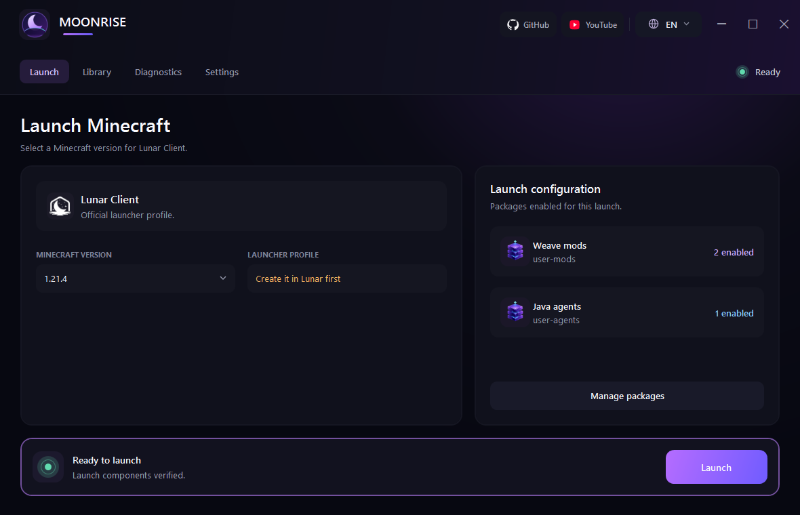
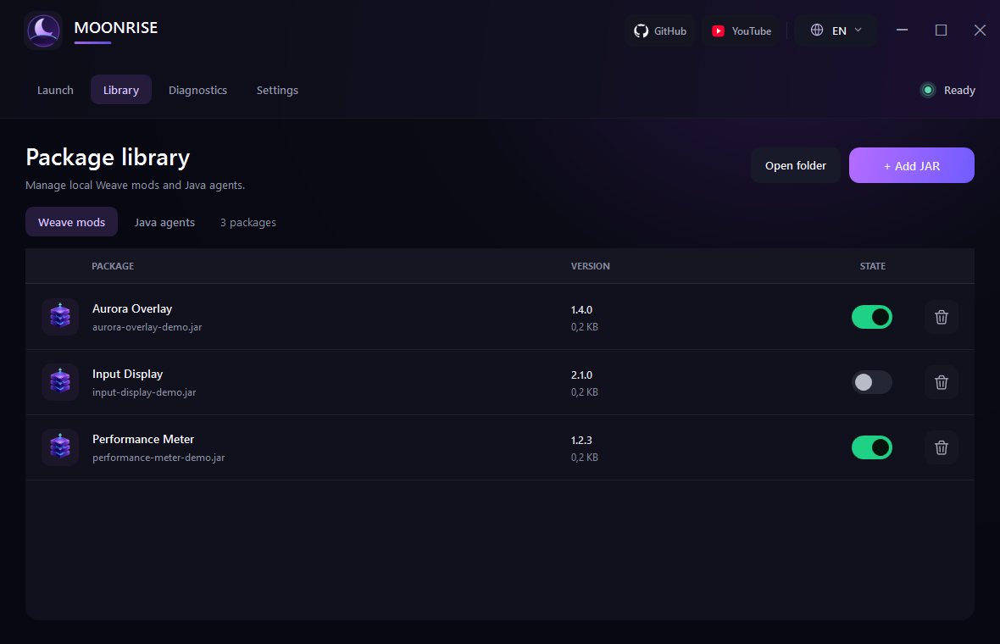
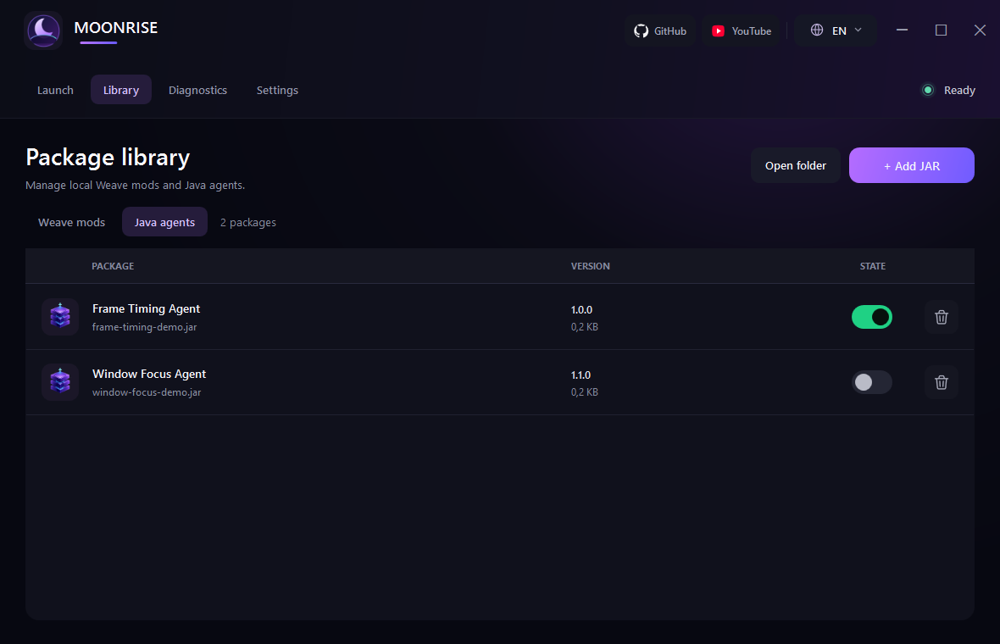
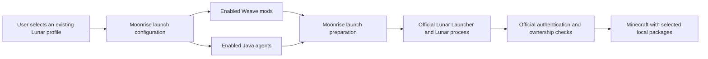
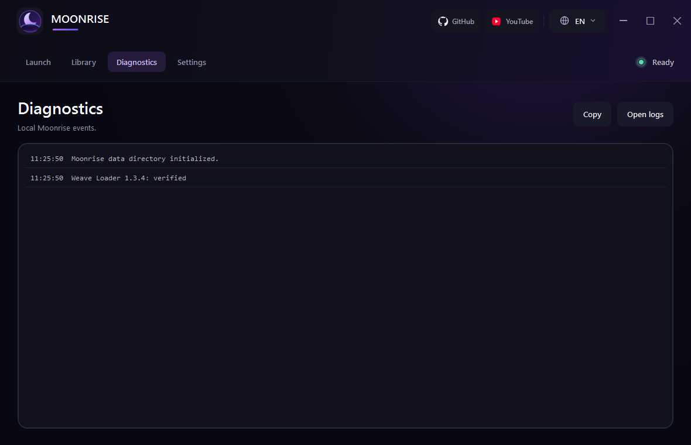

<p align="center">
  
</p>

<h1 align="center">Moonrise</h1>

<p align="center"><strong>A modern mod manager and launcher for Lunar Client.</strong></p>

<p align="center">
  <strong>English</strong> | <a href="README_RU.md">Русский</a> | <a href="docs/roadmap.md"><strong>Roadmap</strong></a>
</p>

<p align="center">
  <a href="https://github.com/ZOONGG/Moonrise/actions/workflows/build.yml"></a>
  <a href="https://github.com/ZOONGG/Moonrise/releases"></a>
  <a href="LICENSE"></a>
  
  
</p>



## What Moonrise is

Moonrise is an open-source Windows application for launching existing official Lunar Client profiles with local Weave mods and Java agents. It organizes packages, prepares an isolated launch configuration, and hands startup to the official Lunar Launcher.

Moonrise is a companion application, not a replacement for the official launcher. It does not implement account authentication, download Lunar Client, or create Minecraft sessions. Users sign in through the official Lunar Launcher, and authentication and ownership checks stay inside official Lunar components.

## Key features

- Detects the official Lunar Launcher and reads existing Lunar profile metadata.
- Selects an existing Minecraft 1.8.9 profile.
- Imports, validates, enables, disables, and removes local Weave mods and Java agents.
- Saves, applies, imports, and exports local launch loadouts without embedding JAR files.
- Provides an offline Package Catalog for Cosmetics/Veyra and optional verified remote catalogs.
- Downloads the official Weave Loader 1.3.4 on demand and verifies its SHA-256 and manifest entry point.
- Checks declared package compatibility before launch and offers a safe-launch mode with third-party packages disabled.
- Shows local diagnostics, redacts common token formats, and creates a local redacted crash analysis after an abnormal game exit.
- Provides equivalent Russian and English controls.
- Tracks launch/process lifecycle and cleanup; opening Moonrise again activates its existing instance.
- Includes launch settings, installer packaging and Velopack beta-update controls for eligible installations.

<p align="center">
  
  
</p>

Screenshots contain synthetic package metadata created only for documentation; those example packages are not shipped. The current catalog separately includes Cosmetics and Veyra.

## How Moonrise works



Moonrise reads the official launcher's profile database to find Lunar profiles, updates only the launcher's selected `gameProfile` setting, creates a temporary snapshot of enabled packages, and starts the official launcher. The official launcher remains responsible for account selection, authentication, ownership checks, downloads, and session creation.

## Requirements

- Windows 10/11 x64; real runtime evidence is from the user's Windows x64 environment, not a certification of every Windows build.
- Official Lunar Launcher installed, signed in, with Minecraft **1.8.9** launched at least once.
- An existing Lunar 1.8.9 profile and trusted packages compatible with that build.

The documented Lunar Launcher baseline is **3.7.23-ow** (ProductVersion 3.7.23.0), with Lunar's Java **17.0.18**. Current recovery scope is Minecraft **1.8.9 only**. Later Lunar updates require another compatibility check. Self-contained packaged builds include .NET 8; source builds require the SDK.

## Installation

**No public release has been published yet.** The owner will publish release assets manually on [GitHub Releases](https://github.com/ZOONGG/Moonrise/releases). Do not treat this link as an available download today.

When a release is available:

1. Read its notes and choose the Windows x64 installer supplied with that release.
2. Compare its SHA-256 with the published checksum before running it:

   ```powershell
   (Get-FileHash .\Moonrise.App-beta-Setup.exe -Algorithm SHA256).Hash
   Get-Content .\Moonrise.App-beta-Setup.exe.sha256
   ```

3. Run `Moonrise.App-beta-Setup.exe`, then start Moonrise from its shortcut. Velopack installs per user into `%LOCALAPPDATA%\Moonrise.App` without administrator rights.
4. Use this production **Velopack** installer for integrated beta updates. Older Inno installations do not become Velopack installations automatically. `Moonrise.UpdateSmoke` builds are local acceptance artifacts and must not be downloaded as a public release.

A ZIP can be used without installation if the release supplies one: extract the **whole** archive to a writable folder and run `Moonrise.exe`. ZIP builds have no integrated Velopack updates. Despite the historical `Portable` filename/marker, current builds keep settings and packages in `%LOCALAPPDATA%\Moonrise`, not beside the EXE. See [installation](docs/INSTALLER.md), [ZIP behavior](docs/PORTABLE_MODE.md), and [updates](docs/UPDATES.md).

Prepared installers are unsigned; Windows may show SmartScreen. Check the source and checksum. Packaged builds are self-contained and do not require a separate .NET installation.

## Automatic updates

Installed **Velopack** builds check the public [Moonrise GitHub Releases](https://github.com/ZOONGG/Moonrise/releases) source on startup when **Check for updates** is enabled. The current channel is **beta**: only newer `-beta.N` versions are accepted, including published prereleases; downgrades are disabled. A stable-channel switch is not implemented.

Open **Settings → Updates** to check manually. **Automatically download updates** is enabled by default; turn it off to use **Download** yourself. Moonrise shows availability, download progress and a ready-to-restart notification. Velopack verifies and stages the package in its installation package directory.

After download, finish Minecraft and current Moonrise operations, then use **Install and restart**. A staged update can also be applied on the next startup through Moonrise's guarded apply path. Velopack's unconditional startup auto-apply is disabled. Application/tray cleanup precedes restart; active launch/game or operations block application. Settings and installed packages remain in the separate LocalAppData data root; the updater does not migrate or replace that root. Real installed-update preservation and apply-failure recovery are still pending acceptance tests.

This requires a real Velopack installation, network access to public GitHub, and manually published matching beta feed/package assets (`releases.beta.json` and full `.nupkg`). ZIP, Inno and development builds have Velopack updates disabled. No production feed is available before the owner publishes a release. See [update details](docs/UPDATES.md).

## First launch

1. Install the official Lunar Launcher.
2. Sign in through the official Lunar Launcher.
3. Create or launch the required Lunar Client profile/version at least once.
4. Close the official launcher completely when Moonrise asks you to do so.
5. Start Moonrise.
6. Select the existing Lunar profile's exact Minecraft version.
7. Add trusted Weave mods and/or Java agents.
8. Enable the packages required for this launch.
9. Select **Launch**.
10. Complete authentication or ownership checks in official Lunar components if prompted.

Moonrise does not request or manage Microsoft, Minecraft, or Lunar account credentials.

## Adding Weave mods

1. Open **Library → Weave mods**.
2. Select **Add JAR** and choose one or more trusted Weave mod JARs.
3. Review the detected name and version.

Moonrise requires `weave.mod.json` and reads its generic package metadata. Importing a JAR validates its structure; it does not establish that the code is safe or compatible.

## Adding Java agents

1. Open **Library → Java agents**.
2. Select **Add JAR** and choose one or more trusted agent JARs.
3. Review the detected title and version.

Import recognizes `Premain-Class` or `Agent-Class` in `META-INF/MANIFEST.MF`, but launch-time `-javaagent` loading requires a valid `Premain-Class`. An attach-only `Agent-Class` declaration is not sufficient for startup.

> [!WARNING]
> Mods and Java agents are executable code. Only load JAR files from sources you trust.

## Enabling and removing packages

- Use the switch beside a package to include or exclude it from future launches.
- Removal deletes the selected Moonrise library copy; keep a backup of imported originals.
- Launch loadouts save version/package selections; exports contain configuration metadata, not JARs.
- You can also drag and drop JARs, or open the data folder and put Weave mods in `packages/weave/` and agents in `packages/agents/`. New files are detected automatically; do not edit `packages/metadata/` manually.

## Package Catalog

The built-in catalog supplies **Moonrise Cosmetics 1.3.2** and **Veyra 0.1.1-moonrise.1** from reviewed bundled artifacts, with SHA-256 verification and offline installation. Open **Catalog**, choose the package, confirm installation, then enable it in **Library**. No separate download URL is needed for these bundled versions.

Optional remote catalogs have separate signature/source/hash checks. A valid signature or hash proves integrity, not runtime compatibility or safety. External-source and unavailable packages must not be treated as one-click installable.

### Moonrise Cosmetics

Our Java agent unlocks and displays Lunar cosmetics locally, preserves cosmetics stores during transient reconnects, and saves/replays outfit selections under `%LOCALAPPDATA%\Moonrise\cosmetics`. **1.3.2** is confirmed by the manifest, source/build pipeline and bundled catalog hash. It includes ASM and can run without a Weave mod or loader. Enable it in the Java-agent library and launch the supported Lunar 1.8.9 profile; standalone local cosmetics and ordinary-mode regression were user-confirmed on the documented Lunar baseline.

Local unlocking **does not guarantee visibility to other players using ordinary Lunar without the agent**. Moonrise Cosmetics Network is future work. Details: [agent documentation](extensions/Moonrise.Cosmetics/README.md).

### Veyra

Our [Veyra Weave mod](https://github.com/ZOONGG/Moonrise-Veyra) derives from the archived [Stormy project by Tryflle and its contributors](https://github.com/Tryflle/stormy). It is evolving its own identity, UI and configuration. The catalog supplies **0.1.1-moonrise.1** for Minecraft 1.8.9 / Weave 1.3.4; **Enter** opens ClickGUI. Current source registers combat, movement, player and render modules, including AimAssist, AutoClicker, Timer, SpeedMine, AutoTool, Array List and ESP modules, with configuration under `.weave/veyra`. Registration is not a claim that every feature has passed runtime testing. Standalone Veyra operation was user-confirmed; shared mixin targets can still conflict with other mods.

Stormy's original authors retain credit for the source foundation. Owner-confirmed redistribution permission is recorded in [third-party notices](THIRD_PARTY_NOTICES.md); neither upstream repository currently declares a public license, so Moonrise's MIT license does not relicense that code. Some modules may violate server rules; use them only where permitted.

## Launch configuration

The **Launch** page shows the exact Minecraft version, matching official Lunar profile, active package counts, and current status. Before starting, Moonrise checks declared package version/dependency information. Errors block that launch; warnings are written to diagnostics.

In **Settings**, **Safe launch** starts a diagnostic session without third-party Weave mods or Java agents. **Close after launch** closes Moonrise only after the game process has been detected. These options do not alter official authentication behavior.

## Diagnostics and logs



The **Diagnostics** page shows local Moonrise initialization, package, compatibility, and launch events. Managed logs are stored under `logs/`; abnormal game exits can produce a redacted text report under `logs/crashes/` with an exit code, a basic classification, recommendations, and up to 100 recent managed diagnostic lines.

Token redaction reduces risk but cannot guarantee that arbitrary third-party text contains no private information. Before sharing a log or crash report, remove personal paths, usernames, account details, identifiers, private package names, and full command lines. Never upload account files or JARs.

## Security and privacy

Moonrise does not request or manage Microsoft, Minecraft or Lunar credentials. Official Lunar components perform authentication and ownership checks. Normal launch uses the existing profile database read-only and changes the selected `gameProfile` launcher setting; it does not implement a replacement login flow.

Current normal, development and ZIP builds share `%LOCALAPPDATA%\Moonrise`:

```text
packages/weave/         installed/imported Weave JARs
packages/agents/        installed/imported Java agents
packages/metadata/      library index and enabled states
settings/               Moonrise settings and loadouts
adapters/               separate compatibility dependencies
cache/                  downloads and runtime preparation
cosmetics/              local outfit selections
temp/                   temporary launch sessions
logs/                   diagnostics; crash analyses in logs/crashes/
```

The executable folder holds bundled application resources. Local update-smoke builds use an isolated data root. Third-party original JARs remain unchanged; adapters and explicitly identified maintained builds are separate. User packages, settings, logs and account data must not be included in release archives. See [storage details](docs/consolidated-user-data.md).

## Compatibility limitations

- Supported scope: official Lunar Client, Minecraft **1.8.9**, Windows x64. Forge/Fabric and arbitrary mod formats are not supported.
- Current Weave **1.3.4** and bounded legacy **0.2.6** paths have different API contracts. Ordinary mode rejects unsupported mixed generations; experimental mixed mode is opt-in and limited to exact supported artifacts.
- Prior user-confirmed combinations include RavenWeave 1.1.4 + maintained BWH and Raven + BWH + unrestricted + Veyra + Cosmetics. These use specific adapters/maintained builds and do not establish direct compatibility of arbitrary upstream JARs. Cosmetics is now 1.3.2; the ordinary-mode regression and repeat launch passed. See [bounded Core evidence](docs/stage1-core-validation-20261012.md).
- Java-agent manifest validation and package metadata cannot prove safety or runtime compatibility. Lunar updates and shared mixin/ASM targets may break packages.
- Open investigations include Raven's missing `changeYaw` callsite, BedPlates shader behavior and observed upstream authentication-service connectivity errors. Do not assume every module works because the menu opens.
- Full standalone close-during-cleanup/tray acceptance and installed Velopack update/apply recovery still need real checks. Stage 1 remains open.
- Moonrise offers no anti-cheat or server-rule bypass guarantee. Back up important configuration before trying new code.

## Troubleshooting

- **Profile missing:** launch Lunar 1.8.9 once through the official launcher and verify its path in Settings.
- **Lunar already running:** close an existing unowned launcher normally, including its tray entry. Do not force-kill unrelated processes.
- **Package fails:** disable the newly added package or use Safe launch, inspect Diagnostics, and check its exact Weave generation and compatibility build. Import success is not runtime success.
- **Updates unavailable:** confirm the build was installed through Velopack; Inno/ZIP/development builds do not use this updater. Retry network failures from Settings → Updates.
- **Restart blocked:** finish Minecraft and ongoing Moonrise operations. Keep Moonrise alive until launch cleanup completes; explicit tray Exit stops its monitoring.
- Before opening an [issue](https://github.com/ZOONGG/Moonrise/issues), include versions and sanitized diagnostics; never upload credentials, account stores or private JARs.

## Building from source

> The build uses reviewed, hash-pinned runtime artifacts supplied with the current source snapshot, including Cosmetics, Veyra and the mixed-Weave adapters. Preserve those assets and accompanying license/source notices. The earlier [Core QA](docs/final-core-qa-20261012.md) missing-artifact finding predates the Final Catalog & Build Fix, which now explicitly includes these files; this documentation pass did not repeat a clean-checkout build.

Requirements: Windows 10/11 x64, the .NET 8 SDK, Git, and PowerShell.

```powershell
git clone https://github.com/ZOONGG/Moonrise.git
cd Moonrise
dotnet restore Moonrise.sln --locked-mode
dotnet build Moonrise.sln -c Release --no-restore
dotnet test Moonrise.sln -c Release --no-build
dotnet publish src/Moonrise/Moonrise.csproj -c Release -r win-x64 --self-contained true --no-restore -o release/Moonrise
```

The application publish uses the reviewed `runtime/bridge/Moonrise.Native.dll` already present in the repository. Branding exports can be regenerated with `tools/generate-brand-assets.ps1`.

## Project structure

```text
assets/branding/         Moonrise vector masters and icon exports
docs/images/en/          current English application screenshots
docs/images/ru/          current Russian application screenshots
extensions/              optional, separately built extension source
native/Moonrise.Native/  native process-bridge source and documentation
runtime/bridge/          redistributable native bridge required at runtime
src/Moonrise/            .NET 8 WPF application
tests/Moonrise.Tests/    xUnit service tests
tools/                   deterministic branding and maintenance utilities
```

## Contributing

Read [CONTRIBUTING.md](CONTRIBUTING.md) before opening a pull request. Keep the core mod-agnostic, preserve Russian/English parity, add tests for behavior changes, and never commit user JARs, account data, logs, settings, tokens, private client material, or generated runtime sessions.

## Reporting security issues

Do not disclose vulnerabilities, credentials, or private files in a public issue. Follow the private process in [SECURITY.md](SECURITY.md).

## Roadmap

The [five-stage Roadmap](docs/roadmap.md) tracks Core, Experience, Catalog & Cosmetics, Expansion and Launch. **Stage 1 remains in progress.** Network cosmetics, other clients/platforms and additional mod formats are plans, not available features or release-date commitments.

## Inspiration & Credits

**Moonrise was inspired by Lunar Client QT.** Thanks to Nilsen84 and the LunarQT contributors for the launcher idea, and to the fork maintainers:

- [Original Lunar Client QT](https://github.com/Nilsen84/lunar-client-qt)
- [Lunar Client QT 2](https://github.com/Nilsen84/lcqt2)
- [Lunar Client QT fork by Youded-byte](https://github.com/Youded-byte/lunar-client-qt)

Moonrise developed as a separate application with its own architecture, interface and compatibility mechanisms. Inspiration does not imply that all Moonrise code was written by LunarQT authors. Veyra's Stormy source ancestry is credited above; shipped ASM, modified legacy Weave components and native dependencies retain their notices in [THIRD_PARTY_NOTICES.md](THIRD_PARTY_NOTICES.md).

## License

Moonrise source code and original Moonrise assets are licensed under the [MIT License](LICENSE). External projects and dependencies retain their own terms; see [THIRD_PARTY_NOTICES.md](THIRD_PARTY_NOTICES.md). The Moonrise MIT License does not grant rights to Lunar Client, Minecraft, Mojang, Microsoft, Weave, third-party mods, Java agents, or user-provided JARs.

## Disclaimer

Moonrise is unofficial and is not affiliated with, sponsored by, or endorsed by Lunar Client, Mojang, Microsoft, or Weave. Minecraft and other names and marks belong to their respective owners. Third-party updates may break compatibility at any time.
